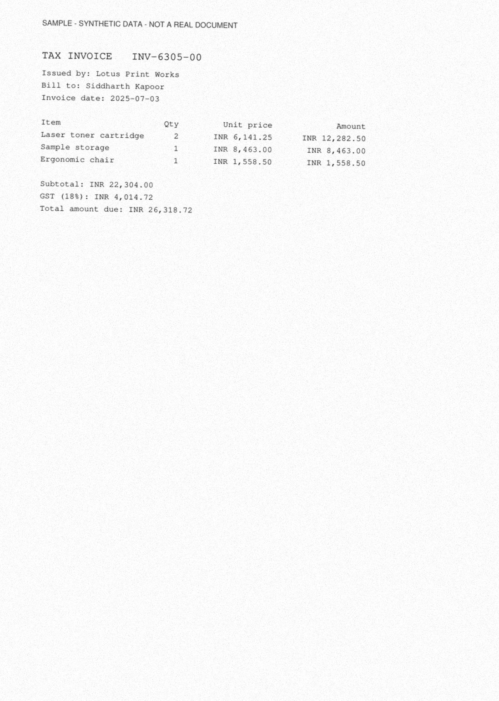
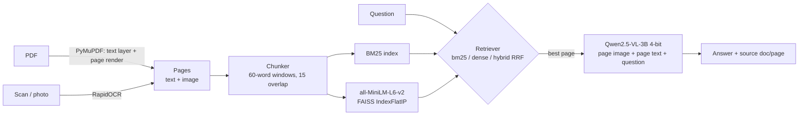
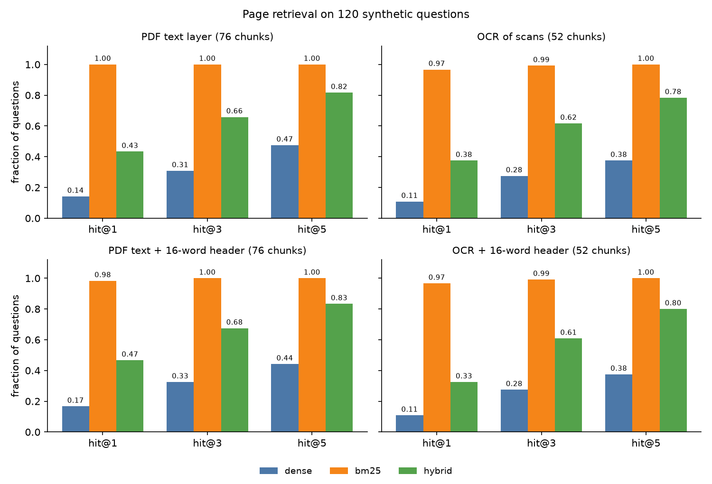

# Multimodal Document RAG

Ask questions about scanned or PDF documents. The system OCRs and indexes the pages, retrieves the right page,
and has a vision-language model (Qwen2.5-VL-3B, 4-bit) read the answer from the page image. It runs on a 4 GB laptop GPU.


## Overview

**Problem.** A lot of useful information sits in scanned documents such as invoices, bank statements and utility bills.
Plain text RAG fails on these because there is no text layer, and even after OCR the layout (tables, columns,
amounts next to labels) is easy to lose. A vision-language model can read a page image well, but it cannot look
through hundreds of pages per question.

**What this project does.** It combines the two:

1. **Ingest** PDFs (text layer plus a rendered page image) and photos/scans (OCR with RapidOCR).
2. **Index** overlapping text chunks with BM25 and with MiniLM embeddings in FAISS.
3. **Retrieve** the page that best matches the question (BM25, dense, or a reciprocal-rank-fusion hybrid).
4. **Read** that page: Qwen2.5-VL gets the page image *and* the page's text and returns a short answer plus its source page.

It also ships a seeded generator for a **synthetic, privacy-safe evaluation set** (45 fictional documents, 120 questions with
known answers), plus scripts that measure retrieval and end-to-end accuracy. Every number below comes from those scripts.

> This repo started as a two-file prototype ("routing not yet wired"). The original scripts were fixed and kept in
> [`examples/`](examples/); the rest is new. See [CHANGELOG.md](CHANGELOG.md).

## Demo

A synthetic scan from the evaluation set (every generated page carries a `SAMPLE - SYNTHETIC DATA` banner):



Retrieval only, no GPU needed ([`results/demo_retrieval_only.txt`](results/demo_retrieval_only.txt)). The scores
are BM25 scores of each page's best chunk:

```text
$ python -m mmrag ask "How many units were consumed for consumer number 913-3945?" --index indexes/ocr --no-vlm
12.7889  bill_002 page 1
6.3431  bill_023 page 1
6.3431  bill_035 page 1
6.3013  bill_017 page 1
6.2600  bill_044 page 1
```

Full pipeline with the Qwen2.5-VL reader on the GPU ([`results/demo_vlm_ask.txt`](results/demo_vlm_ask.txt)). The page
it retrieved is the invoice shown above:

```text
$ python -m mmrag ask "What is the total amount due on invoice INV-6305-00?" --index indexes/ocr
Q: What is the total amount due on invoice INV-6305-00?
A: 26,318.72
Source: invoice_000 page 1 (data/synthetic/scans/invoice_000.jpg)
```

That took 65 s of wall time, about 20 s of which was loading the 4-bit model.

## Architecture



## Tech stack

| Part | Choice |
|---|---|
| PDF parsing and page rendering | PyMuPDF |
| OCR | RapidOCR (PP-OCR models on ONNX Runtime, CPU) |
| Lexical retrieval | BM25 (Okapi, k1=1.5, b=0.75), implemented in `mmrag/index.py` |
| Dense retrieval | sentence-transformers `all-MiniLM-L6-v2` + FAISS `IndexFlatIP` (cosine) |
| Reader | `Qwen/Qwen2.5-VL-3B-Instruct` via transformers 4.51, bitsandbytes NF4, qwen-vl-utils |
| Tooling | pytest, ruff, GitHub Actions |

## Project structure

```
.
├── mmrag/                  # the package
│   ├── ingest.py           # PDF/image -> pages (text + image) -> chunks
│   ├── index.py            # BM25, FAISS dense, RRF hybrid; save/load
│   ├── vlm.py              # Qwen2.5-VL reader (4-bit), prompt, margin trimming
│   ├── pipeline.py         # retrieve best page -> reader -> answer + sources
│   ├── synth.py            # synthetic invoices / statements / bills + QA pairs
│   ├── evaluate.py         # hit@k, MRR, answer accuracy, latency, VRAM
│   └── cli.py              # python -m mmrag ...
├── examples/               # the original two scripts, fixed so they run
├── scripts/
│   ├── run_all.sh          # reproduces the metrics in results/
│   └── plot_retrieval.py   # draws docs/retrieval_hit_at_k.png
├── tests/                  # pytest, CPU only, no model downloads
├── results/                # metrics JSON and per-question predictions
├── docs/                   # sample page and charts
├── data/synthetic/qa.jsonl # the 120 evaluation questions (PDFs/scans are regenerated)
├── requirements.txt        # core (retrieval, OCR, tests)
└── requirements-vlm.txt    # + Qwen2.5-VL extras
```

## Setup

Tested on Windows 10, Python 3.12, PyTorch 2.3.1 (CUDA 11.8), NVIDIA RTX 3050 Ti Laptop GPU (4 GB).

```bash
git clone https://github.com/JaNNi10n/MULTIMODAL_RAG_project1.git
cd MULTIMODAL_RAG_project1
python -m venv .venv
source .venv/bin/activate            # Windows: .venv\Scripts\activate

# 1. PyTorch for your platform (CUDA 11.8 build shown; use the CPU wheel if you have no GPU)
pip install torch==2.3.1 torchvision==0.18.1 --index-url https://download.pytorch.org/whl/cu118

# 2. Core dependencies (enough for ingestion, retrieval, evaluation and tests)
pip install -r requirements.txt

# 3. Optional: the Qwen2.5-VL reader (CUDA GPU, about 7.5 GB download)
pip install -r requirements-vlm.txt
```

Models are downloaded from the Hugging Face Hub on first use. Set `HF_HOME` to put the cache on a disk with space.

## Usage

```bash
# Generate the synthetic corpus: 45 PDFs, 45 degraded scans, 120 questions
python -m mmrag synth --out data/synthetic --n-docs 45 --seed 7

# Index your own files or folders (PDFs and/or images); OCR runs automatically for images
python -m mmrag index data/synthetic/scans --out indexes/ocr

# Retrieval only (no GPU needed)
python -m mmrag ask "How many units were consumed for consumer number 913-3945?" --index indexes/ocr --no-vlm

# Full answer with Qwen2.5-VL (4-bit by default; --no-4bit loads bf16 and needs ~8 GB VRAM)
python -m mmrag ask "What is the total amount due on invoice INV-6305-00?" --index indexes/ocr

# Evaluation
python -m mmrag eval-retrieval --qa data/synthetic/qa.jsonl --index indexes/pdf --index indexes/ocr --out results/retrieval_metrics.json
python -m mmrag eval-qa --qa data/synthetic/qa.jsonl --index indexes/ocr --n 120 --out results/qa_ocr_bm25_full.json
# Ablation: the VLM sees only the page image, no OCR text in the prompt
python -m mmrag eval-qa --qa data/synthetic/qa.jsonl --index indexes/ocr --n 120 --context-chunks 0 \
  --out results/qa_ocr_bm25_image_only_full.json
# Seeded 40-question subsample (--n 40 --seed 0), as in the earlier runs
python -m mmrag eval-qa --qa data/synthetic/qa.jsonl --index indexes/ocr --n 40 --seed 0 --out results/qa_ocr_bm25_idle_gpu.json

# Every metrics file in results/, end to end
bash scripts/run_all.sh

# Tests and lint
pytest -q
ruff check mmrag tests examples scripts
```

Retrieval mode is chosen with `--mode bm25|dense|hybrid` (default `bm25`, see Results for why).

## Results

All numbers below were produced on one machine: Windows 10, Python 3.12.10, PyTorch 2.3.1+cu118, and an NVIDIA RTX 3050
Ti Laptop GPU (4 GB). The raw outputs are in [`results/`](results/). `bash scripts/run_all.sh` regenerates the metrics files, and the two
demo files come from the `ask` commands shown under Demo.

**Data.** The synthetic corpus from `python -m mmrag synth --n-docs 45 --seed 7` has 45 single-page documents
(15 invoices, 15 bank statements, 15 electricity bills) and 120 questions. There is no training step, so there is no
train/test split. Every question is a test question. Nothing was tuned on these questions apart from choosing BM25 as
the default retrieval mode, which was based on the table below.

### Retrieval (all 120 questions)

Page-level metrics: a question counts as a hit at k if the correct document page is among the top k pages, where each
page is ranked by its best chunk. From [`results/retrieval_metrics.json`](results/retrieval_metrics.json):

| Index | Chunks | Mode | hit@1 | hit@3 | hit@5 | MRR@10 | ms / query |
|---|---:|---|---:|---:|---:|---:|---:|
| PDF text layer | 76 | bm25 | 1.000 | 1.000 | 1.000 | 1.000 | 0.9 |
| PDF text layer | 76 | dense | 0.142 | 0.308 | 0.475 | 0.290 | 63.9 |
| PDF text layer | 76 | hybrid | 0.433 | 0.658 | 0.817 | 0.600 | 80.9 |
| OCR of scans | 52 | bm25 | 0.967 | 0.992 | 1.000 | 0.981 | 1.2 |
| OCR of scans | 52 | dense | 0.108 | 0.275 | 0.375 | 0.241 | 79.4 |
| OCR of scans | 52 | hybrid | 0.375 | 0.617 | 0.783 | 0.551 | 60.1 |
| PDF text + 16-word header | 76 | bm25 | 0.983 | 1.000 | 1.000 | 0.989 | 1.4 |
| PDF text + 16-word header | 76 | dense | 0.167 | 0.325 | 0.442 | 0.296 | 45.1 |
| PDF text + 16-word header | 76 | hybrid | 0.467 | 0.675 | 0.833 | 0.619 | 35.1 |
| OCR + 16-word header | 52 | bm25 | 0.967 | 0.992 | 1.000 | 0.981 | 0.9 |
| OCR + 16-word header | 52 | dense | 0.108 | 0.275 | 0.375 | 0.244 | 35.6 |
| OCR + 16-word header | 52 | hybrid | 0.325 | 0.608 | 0.800 | 0.516 | 26.7 |



What the table shows:

- **BM25 wins by a wide margin, and that is a property of this data.** Every question names an identifier (an invoice
  number, account digits or a consumer number), and all documents of one kind share a template. MiniLM embeddings
  capture the topic ("an invoice total") but barely encode `INV-5717-03` versus `INV-3401-09`, so dense retrieval
  cannot tell 15 near-identical invoices apart. Hybrid RRF recovers part of the gap, but the dense ranking still drags
  it down. BM25 is therefore the default mode.
- **OCR costs little.** On the degraded scans BM25 drops from 1.000 to 0.967 hit@1 (4 of 120 questions), and the gold
  page is still in the top 5 for every question. In all four misses the ID was read correctly. The problem was that
  OCR merged the words of the asked-for field, as explained under Limitations.
- **The header prefix is not worth it.** Prefixing chunks with the page's first 16 words changed dense hit@1 by at most
  +2.5 points and slightly lowered BM25 on the PDF text. It stays off by default.
- Latencies are wall-clock times on a shared machine (see Limitations). They show the order of magnitude: BM25 takes
  about 1 ms and dense search takes tens of ms, mostly for encoding the query.

### End-to-end answers with Qwen2.5-VL-3B (4-bit)

Setup: the OCR index (degraded scans, so no PDF text layer), BM25 retrieval, Qwen2.5-VL-3B-Instruct in NF4 4-bit,
and greedy decoding. Two prompt variants were run:

- **image + OCR text**: the top page image plus up to 6 of that page's OCR chunks (the default).
- **image only**: `--context-chunks 0`. The model gets the page image and the question but no OCR text.

**All 120 questions, GPU not shared with other jobs** ([`results/qa_ocr_bm25_full.json`](results/qa_ocr_bm25_full.json),
[`results/qa_ocr_bm25_image_only_full.json`](results/qa_ocr_bm25_image_only_full.json)):

| Metric | image + OCR text | image only |
|---|---:|---:|
| Questions | 120 | 120 |
| Answer accuracy (relaxed exact match) | 0.967 (116 / 120) | 0.967 (116 / 120) |
| Retrieved page correct (hit@1) | 0.967 | 0.967 |
| Answer accuracy when the page was correct | 1.000 (116 / 116) | 1.000 (116 / 116) |
| Latency per question, mean / median | 3.11 s / 3.18 s | 3.03 s / 2.98 s |
| Latency per question, min / max | 1.38 s / 4.61 s | 1.46 s / 4.75 s |
| Peak VRAM (`torch.cuda.max_memory_allocated`) | 2.99 GB | 2.83 GB |

Per-question predictions are in the matching `.predictions.jsonl` files and the console output in the `.log` files.
Latency is per question, including retrieval, with the model already loaded. Loading the 4-bit model takes extra time
once per process.

How to read this:

- **Every error is a retrieval error.** The 4 wrong answers are exactly the 4 questions that BM25 ranks wrong on the OCR
  index (see the retrieval table). In each case the reader correctly read the asked-for value (the total, or the
  Railway e-Ticket payment) from the page it was given, but that page was a different invoice or statement. On the 116 questions where retrieval found the right page, the
  reader was right every time. So better retrieval is what would improve this pipeline, not a bigger reader.
- **This is still a small, easy test set.** The 95% Wilson interval for 116 / 120 is about 92% to 99%. The questions
  are templated and every page is a clean single page (see Limitations).
- **The OCR text is not needed on this data.** With the image alone, Qwen2.5-VL got the same 116 / 120. The two runs
  gave the same string for 78 questions. The other 42 differ only in formatting. Without the OCR text the model added
  a currency prefix (`INR 1,093.00`) 24 times and a unit (`183 kWh`) 13 times, dropped the thousands separator 4 times
  (`1807.50`), and wrote `CorVid` for `Corvid` once. The scorer normalises these away. So on these templated scans the
  model reads the values from the image itself, and the OCR text mainly makes the answer copy the document's exact
  format. The OCR text may still help on harder pages; this data cannot show that. The image-only prompt is shorter and
  used 0.16 GB less peak VRAM, but it was not meaningfully faster.

**Earlier runs on a seeded 40-question subsample** (`--n 40 --seed 0`: 18 invoice, 15 statement and 7 bill questions).
These came first, while other jobs were using the same 4 GB GPU, which made each question very slow. They were
repeated on the idle GPU with the same command:

| Run | Variant | Accuracy | Latency mean / median | Peak VRAM | Files |
|---|---|---:|---:|---:|---|
| GPU shared with other jobs | image + OCR text | 40 / 40 | 56.6 s / 48.6 s | 2.99 GB | [`qa_ocr_bm25.*`](results/qa_ocr_bm25.json) |
| GPU shared with other jobs | image only | 40 / 40 | 30.8 s / 29.2 s | 2.83 GB | [`qa_ocr_bm25_image_only.*`](results/qa_ocr_bm25_image_only.json) |
| GPU not shared | image + OCR text | 40 / 40 | 2.27 s / 2.25 s | 2.99 GB | [`qa_ocr_bm25_idle_gpu.*`](results/qa_ocr_bm25_idle_gpu.json) |
| GPU not shared | image only | 40 / 40 | 2.86 s / 2.77 s | 2.83 GB | [`qa_ocr_bm25_image_only_idle_gpu.*`](results/qa_ocr_bm25_image_only_idle_gpu.json) |

The idle-GPU runs produced exactly the same 40 answer strings as the shared-GPU runs for each variant, because
decoding is greedy. Only the timings changed, by a factor of 10 to 25. The shared-GPU latencies therefore measure
contention with the other jobs, not the model. None of the 4 retrieval misses happened to fall in this subsample,
which is why it scored 40 / 40 while the full set scores 116 / 120.

## How it works

The walkthrough follows one question through the code, with the reason behind each choice.

**1. Synthetic data instead of real documents** (`mmrag/synth.py`). The original prototype used a real scanned bank
statement, which is personal data and must not be in a public repo. It also had no ground truth, so nothing could be
measured. The generator makes 45 one-page documents (15 invoices, 15 bank statements, 15 electricity bills) from a fixed
seed. Every page has a red `SAMPLE - SYNTHETIC DATA` banner. Each document is written twice: as a PDF with a real
text layer, and as a degraded JPEG "scan" (rendered at 130 dpi, rotated by up to 1.5 degrees, blurred, Gaussian noise,
JPEG quality 80). Because the generator writes the numbers itself, it also writes 2 or 3 questions per document with
exact answers, 120 in total.

**2. Ingestion** (`mmrag/ingest.py`). A PDF page gives two things: its text layer (PyMuPDF `get_text`) and a PNG render
for the VLM. A photo or scan has no text layer, so it goes through RapidOCR, the PaddleOCR PP-OCR detector and
recogniser exported to ONNX. It runs on the CPU and installs with pip, with no Tesseract binary. OCR returns boxes in
no fixed order, so lines are sorted top to bottom (y rounded to 10 px bands), then left to right, to keep reading order.

**3. Chunking.** Page text is split into 60-word windows with a 15-word overlap. Small chunks keep a lexical match
precise, and the overlap stops a label from being separated from its value ("Total amount due:" / "INR 26,318.72").
Every chunk keeps `doc_id`, `page` and `image_path`, so a hit can always be traced back to the page image.
`--header-words N` optionally prefixes later chunks with the first N words of their page (title plus document ID). It
is measured as an ablation above.

**4. Indexing** (`mmrag/index.py`). Each chunk is indexed twice:
- *Dense*: `all-MiniLM-L6-v2` embeddings, L2-normalised, in a FAISS `IndexFlatIP`. Inner product on unit vectors is
  cosine similarity. Flat (exact) search is right for a corpus this small. IVF/HNSW would only matter at around 10^5 or
  more chunks.
- *BM25*: Okapi BM25 (k1 = 1.5, b = 0.75), written in about 25 lines with NumPy instead of adding a dependency. The
  tokenizer lowercases and splits on non-alphanumerics, so `INV-6305-00` becomes `inv`, `6305`, `00` and an
  identifier can match even when OCR drops or changes the hyphens.
- *Hybrid*: Reciprocal Rank Fusion (Cormack et al., 2009), `score = sum(1 / (60 + rank))` over both rankings. RRF needs
  no score calibration between BM25 and cosine, which live on different scales.

The index is saved as `chunks.faiss` plus `chunks.jsonl`. On load, BM25 is rebuilt from the chunk text, which takes
milliseconds.

**5. Retrieval routing** (`mmrag/pipeline.py`). This was the missing link in the original prototype ("routing not yet
wired"). Chunks are ranked, and pages are ranked by their best chunk. The top page is the one the VLM reads. Retrieval
works on chunks because they are precise. The reader gets a whole page because the answer has to be read in layout
context (which number sits next to which label). The prompt also gets that page's own chunks in reading order. It does
not get the top-k chunks from other documents, which would put numbers from the wrong invoice in front of the model.
`--mode` defaults to BM25 because of the results above.

**6. Reading** (`mmrag/vlm.py`). Qwen2.5-VL-3B-Instruct is about 7.5 GB in bf16 and does not fit a 4 GB GPU, so it is
loaded with bitsandbytes NF4 4-bit weights, double quantisation and fp16 compute. The input follows the model card
pipeline that the original script was missing: chat message, `apply_chat_template`, `process_vision_info`, then
`processor(...)`. Two settings keep memory bounded:
- `max_pixels = 768 * 28 * 28` caps the image at about 768 visual tokens (Qwen2.5-VL uses one token per 28x28 patch
  after merging).
- `trim_margins` first crops blank paper, because the synthetic pages are mostly white below the text. The same token
  budget then covers the text at a higher resolution.

The prompt contains the OCR text, tells the model to trust the image if the two disagree, and asks for only the value.
With `--context-chunks 0` no OCR text is passed and the retrieved-text slot just says `(none)`. That is how the
image-only ablation in Results was run.
Decoding is greedy with at most 48 new tokens, so the output is deterministic and short enough to score.

**7. Evaluation** (`mmrag/evaluate.py`).
- *Retrieval*: hit@k is the fraction of questions whose gold page is among the top k pages. MRR@10 is the mean of
  1/rank of the gold page, or 0 if it is not in the top 10.
- *Answers*: a relaxed exact match. Both strings are normalised (lowercase, drop `INR`/`Rs.`/`₹`, drop thousands
  separators and trailing decimal zeros, drop punctuation). The gold answer must then appear in the prediction, with a
  digit-boundary guard so that `12.5` does not match `112.55`. The tests cover these cases.
- *Cost*: latency is wall clock per question, including retrieval. Peak VRAM is `torch.cuda.max_memory_allocated()`.

**8. Engineering.** The 22 pytest tests run on a CPU with no model downloads. A fake hashing encoder stands in for
MiniLM, and a stub reader stands in for the VLM. The tests check chunking, BM25, FAISS save/load, OCR on a generated
scan, page routing, answer normalisation and margin trimming. A GitHub Actions workflow
(`.github/workflows/ci.yml`) is set up to run ruff and pytest on pushes to `main` and on pull requests.

## Limitations and next steps

- **The benchmark is easy for lexical search.** Every question contains a unique identifier (invoice number, last 4
  account digits, consumer number), and all documents of a kind share one template. That is why BM25 is near-perfect
  and dense retrieval is poor. The numbers show that this pipeline works on ID-style questions. They do not show how it
  handles open questions such as "which supplier charged the most for printing?". A public benchmark such as DocVQA
  would be the next step.
- **Single-page documents, single-page reading.** The reader sees one page. Answers that span pages, such as a
  multi-page statement total, are out of scope.
- **OCR word merging hurts BM25.** RapidOCR often drops the spaces inside a label, so the scan text reads
  `Totalamountdue:INR 302,846.71` or `Railwaye-Ticket`. Each of the four OCR BM25 misses (three "total amount due"
  invoice questions and one "pay to Railway e-Ticket" statement question) has the right ID in the gold page's text, but
  the field words in the question no longer match it as separate tokens. Another page of the same type where OCR kept
  those spaces then scores higher on "total", "amount" and "due" than the gold page scores on the ID. Each of these
  scan pages is a single chunk, so chunking is not the cause, and the `--header-words` ablation did not change it.
  Possible fixes are character n-gram tokens for OCR text, splitting merged words, or giving an exact identifier match
  more weight.
- **Small end-to-end test set.** 120 questions is small. One question is 0.8 points, and the two prompt variants
  cannot be told apart at this size. Both score 116 / 120, and every error comes from retrieval.
- **Latency numbers depend on what else runs on the laptop.** The first 40-question runs shared the GPU with other jobs
  and took 10 to 25 times longer per question than the same runs on an idle GPU. The retrieval timings were also
  measured on a busy machine. In `results/retrieval_metrics.json` a dense query took between about 35 and 80 ms,
  depending on the index and on the load at that moment.
- **Next steps:** OCR-robust BM25 tokens (see above),
  a cross-encoder reranker, a public DocVQA-style evaluation, batched VLM inference, and a small
  FastAPI or Gradio front end.

## Privacy note on the repository history

The first commit contained a scanned bank statement with personal data (`New folder/your_document.jpg`). It was removed in
a later commit and replaced by synthetic documents, but **it is still present in the git history** of the first commit.
Before this repository is made public again, the history must be purged (for example with `git filter-repo --path "New folder" --invert-paths`
and a force push, or by deleting and recreating the GitHub repository), and any forks or caches checked.

## License and credits

Code: [MIT](LICENSE) © 2026 Shivansh Bhardwaj.

Models and libraries (each under its own license, which applies when you download and use it):

- **Qwen2.5-VL-3B-Instruct**, Qwen team, Alibaba Cloud. Released under the *Qwen Research License*, which restricts commercial use.
  Check it before any non-research use. [Model card](https://huggingface.co/Qwen/Qwen2.5-VL-3B-Instruct), paper: Bai et al., *Qwen2.5-VL Technical Report*, 2025.
- **all-MiniLM-L6-v2**, sentence-transformers (Apache-2.0). [Model card](https://huggingface.co/sentence-transformers/all-MiniLM-L6-v2)
- **RapidOCR** (Apache-2.0), using PaddleOCR PP-OCR models (Apache-2.0).
- **FAISS** (MIT), Meta AI. **PyMuPDF** (AGPL-3.0 or commercial license, Artifex). Note the AGPL terms if you redistribute a service built on it.

Data: the evaluation corpus is fully synthetic and generated by `mmrag/synth.py`. All companies, people, account numbers and amounts are made up.
